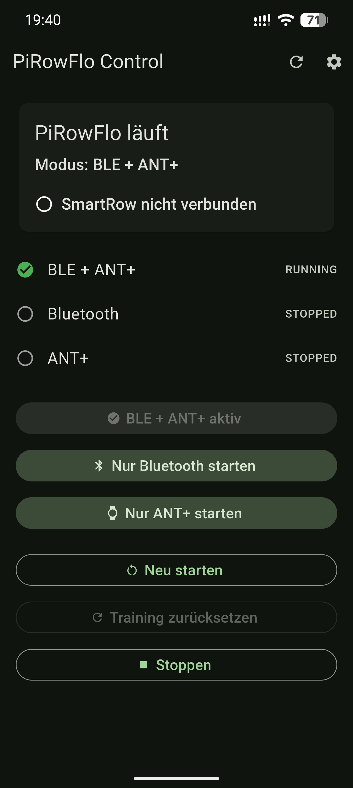

# PiRowFlo Control

Flutter-based Android companion app for PiRowFlo and SmartRow.

PiRowFlo Control provides a mobile interface for controlling a PiRowFlo
installation, monitoring SmartRow live data and running structured rowing
workouts loaded from a Nextcloud calendar.

The app communicates with the
[PiRowFlo Control API](https://github.com/stampede79/pirowflo-control-api).

<p align="center">
  
</p>

## Features

### PiRowFlo control

- Display the current PiRowFlo status
- Display the SmartRow connection status
- Start PiRowFlo in different modes:
  - Bluetooth + ANT+
  - Bluetooth only
  - ANT+ only
- Restart PiRowFlo
- Stop PiRowFlo
- Reset the current SmartRow training session
- Configure the PiRowFlo server and API key
- Configure the app using a QR code

### SmartRow live metrics

During a workout the app displays live SmartRow data provided by PiRowFlo:

- Power in watts
- Stroke rate (SPM)
- Pace per 500 m
- Distance
- SmartRow connection state

The workout screen polls the PiRowFlo Control API for live metrics while
PiRowFlo continues to handle the SmartRow connection and its Bluetooth / ANT+
outputs.

This allows SmartRow data to be used by the app without requiring a second
direct Bluetooth connection to SmartRow.

### Power target guidance

Workout steps can define a target power range.

The current power value is color-coded:

- Green: inside the target range
- Orange: up to 5% outside the target range
- Red: more than 5% outside the target range

The displayed watt value always represents the current SmartRow measurement.

### Nextcloud training calendar

PiRowFlo Control can load the planned workout for the current day from a
Nextcloud calendar using CalDAV.

The following settings are stored securely on the Android device:

- CalDAV calendar URL
- Nextcloud username
- Nextcloud app password

A calendar connection test is available from the app settings.

Normal calendar descriptions can be combined with a machine-readable
`[PIROWFLO]` block.

Example:

```text
[PIROWFLO]
warmup=7m
repeat=5
work=3m,135-145w
recovery=2m,90-100w
cooldown=5m
[/PIROWFLO]
```

This produces:

```text
7 min warm-up

5 x:
  3 min at 135-145 W
  2 min at 90-100 W

5 min cool-down
```

Stroke-rate targets are also supported:

```text
[PIROWFLO]
warmup=5m
work=40m,105-110w,16-18spm
cooldown=5m
[/PIROWFLO]
```

Calendar events without a `[PIROWFLO]` block are not treated as runnable
workouts.

### Guided workout runner

Structured workouts are executed step by step in the app.

The workout screen provides:

- Current workout step
- Remaining step time
- Progress indicator
- Current power
- Target power
- Stroke rate
- Pace
- Distance
- SmartRow live/offline status
- Pause and resume
- Manual step skipping

The Android display is kept awake while the workout screen is open.

### Audio cues

The workout runner provides audio feedback so the display does not need to be
watched continuously.

- Countdown signals at 3, 2 and 1 seconds
- Separate signal when a work interval begins
- Separate signal when a recovery or cool-down begins
- Completion signal when the workout finishes

### Workout recording

SmartRow metrics are recorded for each workout step while the workout is
running.

The result of each step includes:

- Actual duration
- Average power
- Average stroke rate
- Average pace
- Distance
- Percentage of active power samples inside the target range

Zero-power / idle samples are excluded from power target evaluation.

After the final step, the app displays a workout result screen containing the
individual step results and an overall workout summary.

The overall summary includes:

- Total training time
- Total distance
- Average power
- Average stroke rate
- Average pace
- Overall percentage inside configured power target ranges

Workout results are currently kept in memory only and are not yet persisted.

## Architecture

```text
                         Nextcloud
                            |
                            | CalDAV
                            v
                    PiRowFlo Control App
                            |
                            | HTTP / REST
                            v
                    PiRowFlo Control API
                            |
                  +---------+---------+
                  |                   |
          Supervisor control      Unix socket
                                      |
                                      v
                                  PiRowFlo
                                      |
                    +-----------------+-----------------+
                    |                 |                 |
                 SmartRow        Bluetooth / FTMS      ANT+
                    |
                    v
              Live metrics
                    |
                    +----> Control API ----> App
```

SmartRow remains connected to PiRowFlo. The Android app does not connect
directly to SmartRow.

This keeps the existing PiRowFlo Bluetooth / FTMS and ANT+ data paths
independent from the workout UI.

## Components

The components are maintained in separate repositories:

- [PiRowFlo](https://github.com/stampede79/pirowflo)
- [PiRowFlo Control API](https://github.com/stampede79/pirowflo-control-api)
- [PiRowFlo Control App](https://github.com/stampede79/pirowflo-control-app)

For a complete Raspberry Pi installation, see:

- [PiRowFlo Installer](https://github.com/stampede79/pirowflo-installer)

## Requirements

To build the app you need:

- Flutter 3.47.2 or a compatible newer version
- Dart 3.13.2 or a compatible newer version
- Android SDK
- Java / JDK required by the installed Flutter version
- Git
- an Android device or emulator

Check the Flutter environment with:

```bash
flutter doctor
```

Resolve any reported Android toolchain issues before building the app.

## Clone the repository

```bash
git clone https://github.com/stampede79/pirowflo-control-app.git
cd pirowflo-control-app
flutter pub get
```

## Development

Check the project with:

```bash
flutter analyze
flutter test
```

Run it on a connected development device:

```bash
flutter devices
flutter run
```

## Build an Android APK

### Debug APK

```bash
flutter build apk --debug
```

Result:

```text
build/app/outputs/flutter-apk/app-debug.apk
```

### Release APK

```bash
flutter build apk --release
```

Result:

```text
build/app/outputs/flutter-apk/app-release.apk
```

## Install using ADB

For a connected Android device:

```bash
adb install -r build/app/outputs/flutter-apk/app-debug.apk
```

The APK can alternatively be copied to the Android device and installed
manually.

## App configuration

Open the settings using the gear icon in the upper-right corner.

### PiRowFlo server

Enter the complete base URL of the PiRowFlo Control API including protocol and
port.

Example:

```text
http://192.168.178.123:8090
```

Do not append `/api/status`, `/api/metrics` or another API path.

### API key

The Control API uses an API key sent by the app using the `X-API-Key` HTTP
header.

The key is configured on the PiRowFlo host through the Control API environment
configuration.

The server address and API key are stored locally using Flutter Secure Storage.

Keep the API key private.

### Nextcloud calendar

Configure:

- CalDAV calendar URL
- Nextcloud username
- Nextcloud app password

Example calendar URL:

```text
https://cloud.example.com/remote.php/dav/calendars/USER/training/
```

Use a dedicated Nextcloud app password instead of the normal account password.

The app provides a calendar test function before using the configuration for
workouts.

## PiRowFlo Control API

The app currently uses endpoints including:

```text
GET  /api/status
GET  /api/metrics

POST /api/start/combined
POST /api/start/bluetooth
POST /api/start/ant
POST /api/restart
POST /api/reset
POST /api/stop
```

`/api/metrics` exposes normalized SmartRow live data such as:

```json
{
  "smartrow_connected": true,
  "smartrow_ready": true,
  "rowing": true,
  "power_w": 139,
  "stroke_rate_spm": 24,
  "pace_500m_seconds": 139,
  "distance_m": 1240,
  "elapsed_seconds": 420
}
```

## Troubleshooting

### App cannot reach PiRowFlo

Verify that the Control API is running:

```bash
systemctl status pirowflo-control.service
```

Check that port `8090` is reachable from the Android device.

### SmartRow is offline

The app distinguishes between the Control API being reachable and SmartRow
being connected.

Check PiRowFlo:

```bash
/opt/pirowflo/venv/bin/supervisorctl \
  -c /opt/pirowflo/services/supervisord.conf \
  status
```

Check the PiRowFlo log:

```bash
tail -n 100 /opt/pirowflo/src/pirowflo.log
```

### Nextcloud calendar cannot be accessed

Verify the CalDAV URL and use a valid Nextcloud app password.

A working CalDAV calendar should respond successfully to an authenticated
`PROPFIND` request.

### No live workout values

Verify:

1. PiRowFlo is running.
2. SmartRow is connected.
3. SmartRow services are resolved.
4. `/api/metrics` is reachable.
5. The API key is correct.

## Current limitations / planned work

The following features are not implemented yet:

- Persistent workout history
- Saving completed workout results
- Synchronizing workout results back to Nextcloud
- Historical workout analysis and trends
- Additional workout result visualizations
- Optional smoothing of live power target feedback
- Garmin Connect IQ integration

## Related projects

- [PiRowFlo](https://github.com/stampede79/pirowflo)
- [PiRowFlo Control API](https://github.com/stampede79/pirowflo-control-api)
- [PiRowFlo Installer](https://github.com/stampede79/pirowflo-installer)
