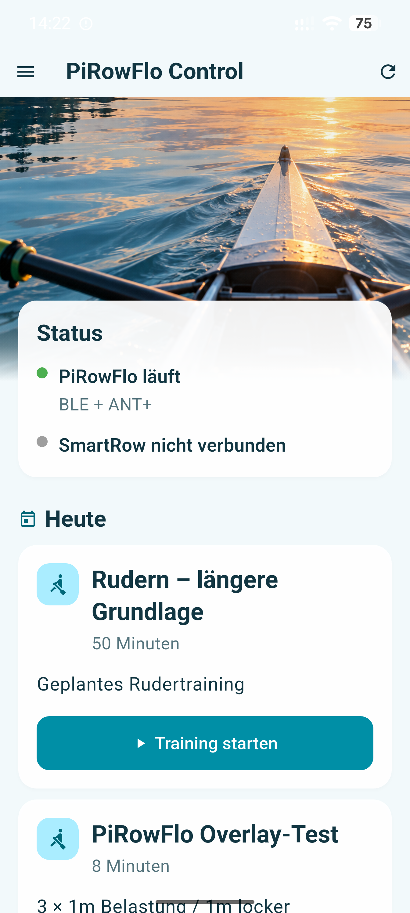
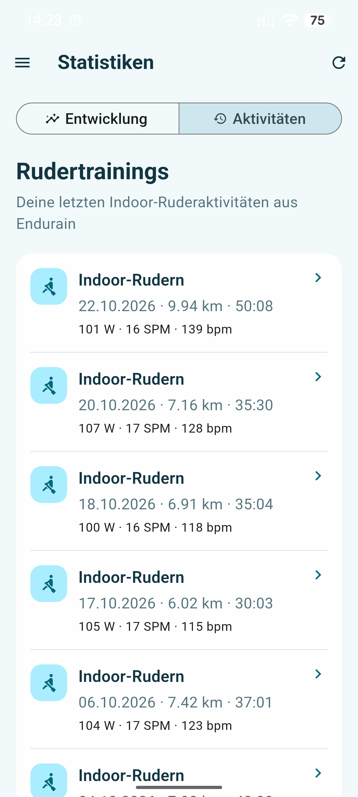
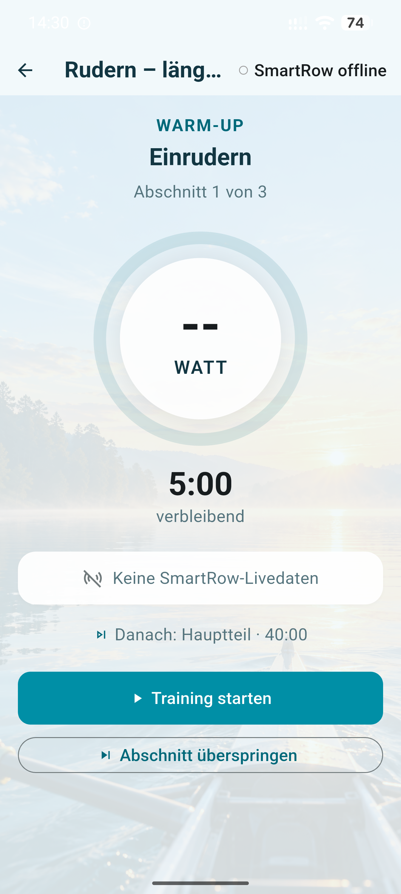
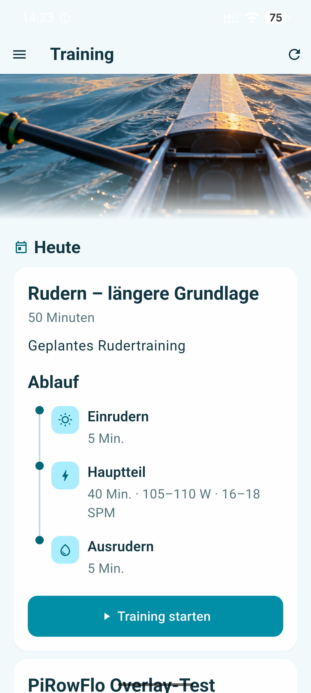
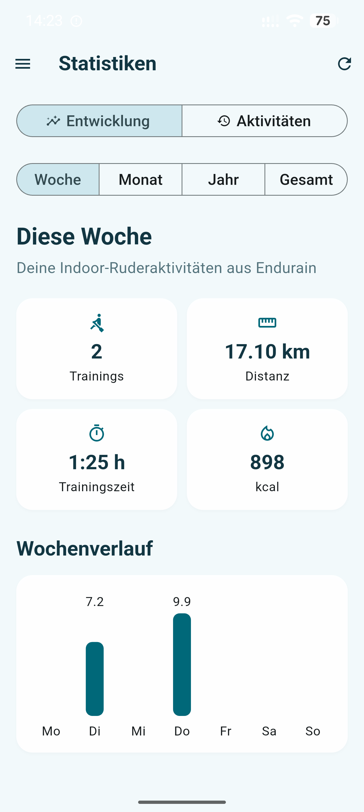
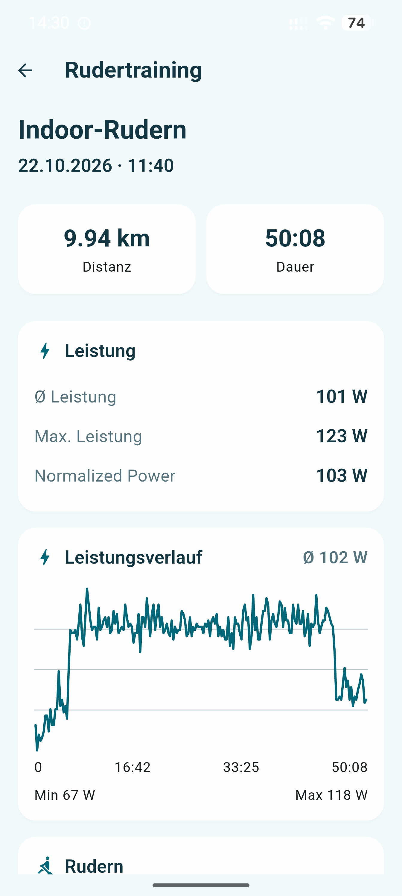

# PiRowFlo Control

Flutter-based Android companion app for **PiRowFlo**, **SmartRow** and the
PiRowFlo training Coach.

PiRowFlo Control combines rowing workouts, SmartRow live metrics,
training planning, Endurain activities and statistics, Coach analyses
and PiRowFlo system control in a single Android application.

The app communicates with the
[PiRowFlo Control API](https://github.com/stampede79/pirowflo-control-api).

SmartRow remains connected to PiRowFlo. The Android app receives
normalized live metrics through the Control API instead of establishing
a second Bluetooth connection to SmartRow.

**Current release:** v0.1.1
**Build:** 2

---

## Screenshots

<p align="center">
  
  &nbsp;&nbsp;
  
</p>

<p align="center">
  
  &nbsp;&nbsp;
  
</p>

<p align="center">
  
  &nbsp;&nbsp;
  
</p>

---

## Features

### PiRowFlo control

The app provides a mobile interface for a PiRowFlo installation.

Supported functions include:

- display of the active PiRowFlo operating mode
- SmartRow connection and readiness state
- SmartRow Bluetooth hardware status
- ANT+ hardware availability
- Bluetooth + ANT+ mode
- Bluetooth-only mode
- ANT+-only mode
- PiRowFlo restart
- PiRowFlo stop
- SmartRow session reset
- QR-code configuration

The app distinguishes between PiRowFlo API availability, SmartRow
connection state and the underlying Bluetooth hardware state.

### Guided rowing workouts

Structured workouts are executed step by step.

The workout runner provides:

- warm-up, work, recovery and cool-down steps
- power targets
- stroke-rate targets
- pace targets
- remaining step time
- step progress
- pause and resume
- manual step changes
- pre-workout countdown
- previews before upcoming steps
- audio cues
- workout results

The Android display is kept awake while a workout is running.

### SmartRow live metrics

During a workout the app polls normalized SmartRow metrics from the
PiRowFlo Control API.

Displayed values include:

- power
- stroke rate
- pace per 500 m
- distance
- SmartRow connection state

The Flutter app does not open another SmartRow Bluetooth connection.

### Heart-rate sensor

An optional Bluetooth heart-rate sensor can be connected directly by the
Android app during a workout.

Heart-rate handling is independent from the SmartRow connection and
includes automatic reconnection and stale-data detection.

### Workout recording

SmartRow metrics are aggregated for each workout step.

Step results include:

- actual duration
- average power
- average stroke rate
- average pace
- distance
- percentage of active power samples inside the configured target range

After the workout, individual step results and an overall summary are
displayed.

### Training overview

The training area combines:

- today's workouts
- upcoming workouts
- monthly training-plan drafts
- training-plan reviews
- completed planned workouts
- missed workouts
- skipped workouts
- free rowing activities

Planned workouts and completed Endurain activities can be linked.

Existing persistent links have priority over automatic matching.

Activities that do not belong to a planned workout are shown as free
training sessions.

### Offline workout cache

Previously retrieved workout planning data is cached locally.

If the PiRowFlo Control API is temporarily unavailable, the app can fall
back to cached workout information.

The cache is intentionally limited to planning data and does not provide
offline replacements for live backend functions.

### Endurain integration

PiRowFlo Control connects directly to Endurain for:

- authentication
- rowing activities
- rowing statistics
- activity metadata

Access and refresh tokens are stored securely and access tokens are
refreshed automatically when possible.

Statistics are available for:

- week
- month
- year
- lifetime

### Detailed activity charts

Historical activity metadata originates from Endurain.

Prepared chart streams are loaded through the PiRowFlo Control API using
the Endurain activity ID.

Available streams include:

- power
- stroke rate
- heart rate

This separation allows stream preparation and signal cleanup to remain
centralized in the PiRowFlo backend.

### PiRowFlo Coach

The Coach provides several levels of training feedback:

- individual Workout Analysis
- Weekly Review
- Monthly Review
- availability questions
- replanning recommendations
- monthly training planning
- training-plan review

The Coach logic runs in the PiRowFlo Control API environment.

The Flutter app displays Coach results and sends user decisions back to
the backend.

### Monthly training planning

The Coach can generate a personalized monthly training-plan draft.

Planning can take into account:

- previous planned workouts
- completed workouts
- actual performance data
- Workout Analyses
- Weekly Reviews
- final Monthly Review
- availability decisions
- personal calendar entries
- deterministic planning constraints

Unavailable dates are hard constraints and are validated after plan
generation.

The generated plan remains a draft until it is applied.

### Plan review

An existing monthly plan can be reviewed when circumstances change.

The reviewer attempts to keep the existing plan stable and only proposes
changes when there is a concrete reason.

Possible actions include:

- keep
- move
- skip
- modify

---

## Workout format

Structured workouts use a `[PIROWFLO]` block.

Example:

```text
[PIROWFLO]
warmup=7m
repeat=5
work=3m,135-145w
recovery=2m,90-100w
cooldown=5m
[/PIROWFLO]
```

Stroke-rate targets can be added:

```text
[PIROWFLO]
warmup=5m
work=40m,105-110w,16-18spm
cooldown=5m
[/PIROWFLO]
```

Workout steps can contain combinations of:

- duration
- power target
- stroke-rate target
- pace target

---

## Architecture

The application uses several independent data sources.

```text
                         Nextcloud
                            |
                   calendar / availability
                            |
                            v
                    PiRowFlo backend
                            ^
                            |
                    PiRowFlo Control App
                     /               \
                    /                 \
       PiRowFlo Control API          Endurain
                |                       |
                |                       +-- Activities
                |                       +-- Statistics
                |
                +-- Control
                +-- Hardware status
                +-- Live metrics
                +-- Workouts
                +-- Activity links
                +-- Activity streams
                +-- Training history
                +-- Coach
                +-- Training planning
```

SmartRow remains connected to PiRowFlo.

The optional heart-rate sensor is the exception and is connected directly
by the Flutter app.

### Flutter architecture

`main.dart` acts as the application orchestration layer.

HTTP communication is implemented by domain-specific services such as:

- `ControlService`
- `MetricsService`
- `WorkoutService`
- `TrainingHistoryService`
- `TrainingPlanService`
- `CoachService`
- `ActivityStreamService`
- `EndurainService`

Screens primarily contain presentation and local UI state.

---

## Technical documentation

Detailed documentation is available in `docs/`:

- [Architecture](docs/architecture.md) – application structure and service responsibilities
- [Data Flow](docs/data-flow.md) – workouts, activities, matching, streams and analyses
- [Coach](docs/coach.md) – Workout Analysis, reviews and monthly planning
- [Offline Cache](docs/offline-cache.md) – local workout-cache behavior

---

## Components

The system is maintained across separate repositories:

- [PiRowFlo](https://github.com/stampede79/pirowflo)
- [PiRowFlo Control API](https://github.com/stampede79/pirowflo-control-api)
- [PiRowFlo Control App](https://github.com/stampede79/pirowflo-control-app)
- [PiRowFlo Installer](https://github.com/stampede79/pirowflo-installer)

---

## Requirements

To build the app you need:

- Dart 3.13.2 or a compatible version
- a compatible Flutter SDK
- Android SDK
- Java / JDK required by Flutter
- Git
- Android ARM64 device or emulator

Check the Flutter environment with:

```bash
flutter doctor
```

---

## Clone

```bash
git clone https://github.com/stampede79/pirowflo-control-app.git
cd pirowflo-control-app
flutter pub get
```

---

## Development

Before committing changes:

```bash
flutter analyze
flutter test
```

The current test suite covers models and important non-UI training logic,
including workout parsing, matching, history merging, workout-step
recording and PiRowFlo status parsing.

### Development build

The development flavor can be installed alongside the production app and
uses separate application data.

Build manually:

```bash
flutter build apk \
  --flavor dev \
  --debug \
  --target-platform android-arm64
```

Or use:

```bash
./publish-dev.sh
```

The publish script automatically runs:

```text
flutter analyze
flutter test
```

before building and publishing the APK.

The launcher name is:

```text
PiRowFlo-Controller Dev
```

---

## Production build

The production launcher name is:

```text
PiRowFlo-Controller
```

Build manually:

```bash
flutter build apk \
  --flavor prod \
  --release \
  --target-platform android-arm64
```

Result:

```text
build/app/outputs/flutter-apk/app-prod-release.apk
```

Or use:

```bash
./publish-release.sh
```

The release script:

1. runs `flutter analyze`
2. runs `flutter test`
3. builds the ARM64 production APK
4. calculates size and SHA-256
5. publishes a versioned APK
6. updates `pirowflo-control.apk` as the latest release
7. updates the download page

The application version is defined in `pubspec.yaml`.

Current value:

```yaml
version: 0.1.1+2
```

---

## App configuration

Open **Settings** from the navigation drawer.

### PiRowFlo server

Enter the base URL of the PiRowFlo Control API.

Example:

```text
http://192.168.178.123:8090
```

Do not append an API endpoint such as `/api/status`.

A trailing slash is accepted and normalized internally.

### API key

The PiRowFlo Control API uses an API key sent through the `X-API-Key`
HTTP header.

The server URL and API key are stored using Flutter Secure Storage.

Keep the API key private.

### Endurain

Configure the Endurain server and credentials in the app.

After login, authentication tokens are stored securely.

### QR configuration

PiRowFlo server configuration can also be imported using a QR code.

---

## Troubleshooting

### App cannot reach PiRowFlo

Verify that the PiRowFlo Control API is running and that its port is
reachable from the Android device.

A reachable base URL alone is not sufficient for authenticated API
endpoints; the configured API key must also be valid.

### SmartRow is offline

PiRowFlo API availability and SmartRow connectivity are separate states.

Verify:

1. PiRowFlo is running.
2. The SmartRow Bluetooth adapter is available and powered.
3. SmartRow is connected.
4. SmartRow services are resolved.
5. `/api/metrics` can be reached with the configured API key.

### Planned workouts are visible while PiRowFlo is offline

This can be expected.

PiRowFlo Control maintains a local workout cache and may display
previously retrieved planning data when the backend is unavailable.

The UI indicates when cached workout data is being used.

### Activity exists but charts cannot be loaded

Activity metadata and chart streams use different data paths.

The activity originates from Endurain, while the prepared chart streams
are loaded through the PiRowFlo Control API.

Therefore Endurain may be reachable while the activity charts are
temporarily unavailable because PiRowFlo cannot be reached.

### Endurain statistics cannot be loaded

Verify:

- Endurain is reachable
- the configured Endurain server is correct
- authentication is valid
- the Endurain session can be refreshed

---

## Releases

### v0.1.1

Current release.

Highlights include:

- improved application startup behavior
- workout offline cache
- training history with planned and free sessions
- workout/activity matching and persistent linking
- detailed activity streams
- Coach integration
- Weekly and Monthly Reviews
- monthly training planning
- training-plan review
- SmartRow hardware status
- Bluetooth heart-rate support
- improved error handling
- responsive phone and tablet training views

### v0.1.0

Initial public release.

---

## Roadmap

Possible future work includes:

- persistence or synchronization of workout-runner results
- additional long-term performance trends
- additional workout result visualizations
- further Coach and recovery-data integration
- optional Garmin integration

---

## Related projects

- [PiRowFlo](https://github.com/stampede79/pirowflo)
- [PiRowFlo Control API](https://github.com/stampede79/pirowflo-control-api)
- [PiRowFlo Installer](https://github.com/stampede79/pirowflo-installer)